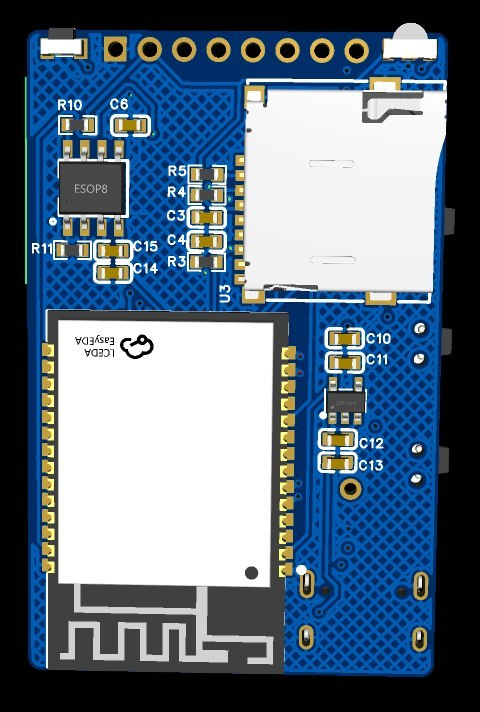
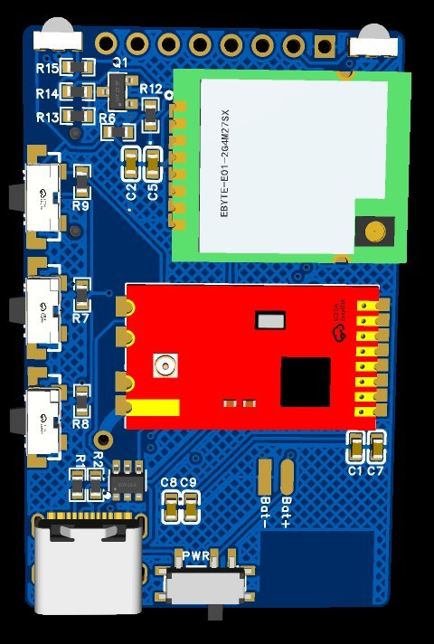

  

<h1 align="center">ESP32-C5 Custom Board — Bruce Pinout Guide</h1>

  
  
  

<em>Pinout and wiring reference for a custom ESP32-C5 board using Bruce firmware.</em>

> **Note:** This document describes a custom board and its wiring. Confirm the pin assignments, voltage levels, and module requirements for your board revision before connecting or powering hardware.

## Contents

- [SPI and primary modules](#spi-and-primary-modules)
- [Buttons](#buttons)
- [Touchscreen configuration](#touchscreen-configuration)
- [Other peripherals](#other-peripherals)
- [Shared pins and hardware notes](#shared-pins-and-hardware-notes)
- [PCB photos](#pcb-photos)
- [Credits](#credits)

## SPI and primary modules

The display, SD card, and radio modules share the SPI bus. The CC1101, NRF24, and W5500 use shared module-control pins in this design.

| Device | SCK | MISO | MOSI | CS | GDO0 / CE | TFT_DC | TFT_RST | TFT_BL |
|:--|:--:|:--:|:--:|:--:|:--:|:--:|:--:|:--:|
| Display | GPIO 6 | GPIO 2 | GPIO 7 | GPIO 23 | — | GPIO 24 | C5 RST | GPIO 25 |
| SD card | GPIO 6 | GPIO 2 | GPIO 7 | GPIO 10 | — | — | — | — |
| CC1101 | GPIO 6 | GPIO 2 | GPIO 7 | GPIO 9* | GPIO 8* | — | — | — |
| NRF24 | GPIO 6 | GPIO 2 | GPIO 7 | GPIO 9* | GPIO 8* | — | — | — |
| W5500 | GPIO 6 | GPIO 2 | GPIO 7 | GPIO 9* | GPIO 8* | — | — | — |

\* **Shared module pins:** CC1101, NRF24, and W5500 share the same pin assignments. Add suitable switching on CS and CE/GDO0 to select which module is connected for use.

## Buttons

Use these GPIO assignments when adding physical buttons:

| Button | GPIO |
|:--|:--:|
| Previous | GPIO 0 |
| Select | GPIO 28 |
| Next | GPIO 1 |

## screen configuration

For an ST7789 1.69 inch TFT display, use the following SPI connections. In this configuration, GPIO 0 and GPIO 28 remain available for CC1101/NRF24 use.

| Device | SCK | MISO | MOSI | CS | IRQ |
|:--|:--:|:--:|:--:|:--:|:--:|
| Display | GPIO 6 | GPIO 2 | GPIO 7 | GPIO 23 | — |

## Other peripherals

| Peripheral | RX | TX | GPIO / connection |
|:--|:--:|:--:|:--|
| GPS | GPIO 4 | GPIO 5 | Shares GPIO 4 and 5 with I²C; see notes below. |
| IR receiver | — | — | GPIO 26 |
| IR transmitter | — | — | GPIO 3 |
| LED | — | — | GPIO 27 |
| I²C SDA | — | — | GPIO 4 |
| I²C SCL | — | — | GPIO 5 |
| Serial link to another device (e.g. Flipper) | GPIO 12 (RX) | GPIO 11 (TX) | UART connection |

## Shared pins and hardware notes

- **GPS and I²C share GPIO 4 and GPIO 5.** These pins are assigned to GPS RX/TX or I²C SDA/SCL, so plan for one function at a time unless your hardware provides a suitable switching arrangement.
- FM radio, PN532, and other I²C peripherals connect through the I²C bus on GPIO 4 (SDA) and GPIO 5 (SCL).
- The ESP32-C5 does not support USB-OTG. For BadUSB functionality, use a CH9329 module.
- CC1101, NRF24, and W5500 share GPIO 9 (CS) and GPIO 8 (GDO0/CE) in this pinout. Use appropriate switching to select the intended module.
- Check your board schematic and each module’s electrical requirements before powering the circuit.

## PCB photos

  

<strong>Custom board</strong>

  

<strong>PCB detail</strong>

## Credits

- **Firmware:** [Bruce firmware](https://github.com/brucedevices/firmware) — an open-source project maintained by the Bruce contributors.
- **Custom board and pinout:** Community hardware documentation by [Umtan](https://github.com/umtan234).

Please visit the Bruce repository for its documentation, license, and project details.
